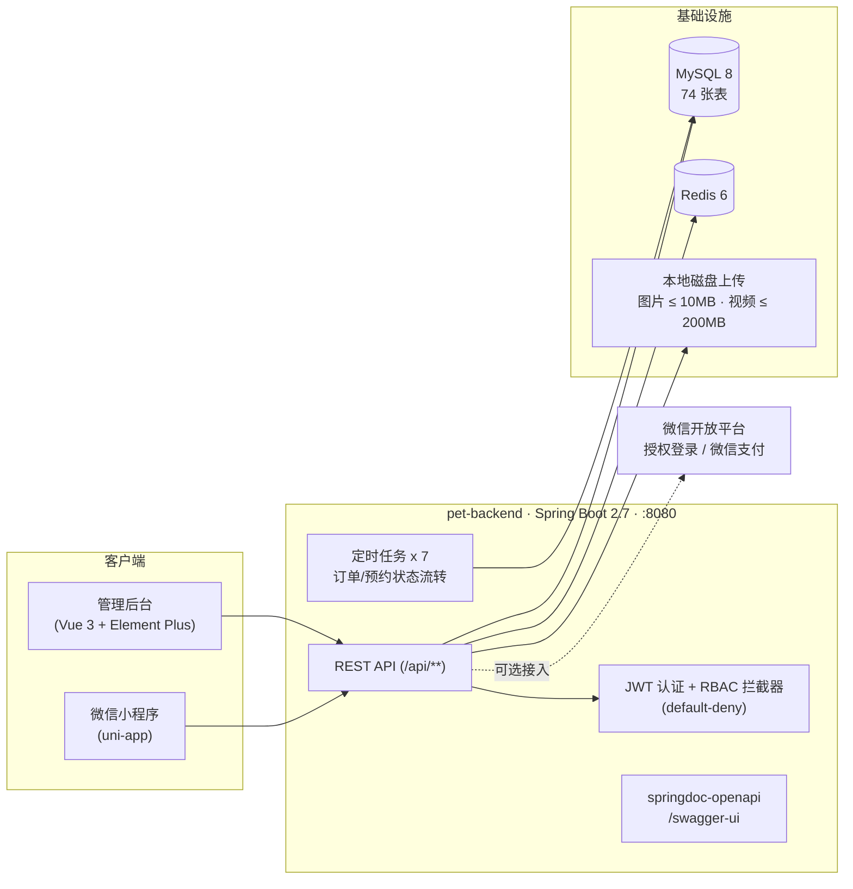

<div align="center">

# Pet Home · 宠物之家

**面向 C 端宠物主人的一站式服务平台**

商城交易 · 三类服务预约 · 宠物社区 · 积分营销 · 宠物健康档案 · Web 管理后台

[](./LICENSE)
[](https://spring.io/projects/spring-boot)
[](https://openjdk.org/)
[](https://vuejs.org/)
[](https://www.mysql.com/)
[](https://uniapp.dcloud.net.cn/)
[](https://github.com/YuWithYu/pet-home/pulls)

[快速开始](#快速开始) · [功能总览](#功能总览) · [界面演示](#界面演示) · [系统架构](#系统架构) · [技术栈](#技术栈) · [文档](#文档导航)

</div>

---

## 项目简介

宠物之家是一个前后端分离的三端项目，为宠物主人提供从「买用品、约服务、逛社区」到「管健康」的完整闭环：

- **微信小程序**（C 端）：商城下单与微信支付、上门铲屎 / 宠物洗护 / 宠物医院三类服务预约、社区互动、积分与优惠券、宠物健康档案。
- **Web 管理后台**（B 端）：数据看板、用户 / 商品 / 订单 / 预约 / 员工 / 门店 / 内容等全量业务管理，基于 RBAC 的权限体系。
- **后端 API**：Spring Boot 单体服务，JWT 认证 + 角色拦截，74 张表的关系模型，7 个定时任务驱动订单与预约的状态流转。

本项目按企业级研发流程构建：统一响应结构与全局异常处理、参数化 SQL、敏感配置全量环境变量化、文件上传分级限额、默认拒绝（default-deny）的接口权限模型。完整的设计取舍与工程约定见 [开发计划书.md](开发计划书.md)。

## 功能总览

| 模块 | 能力 |
|---|---|
| 商城交易 | 商品浏览、购物车、下单、微信支付 / 模拟支付、物流跟踪、退款申请与审批、订单评价 |
| 服务预约 | 上门铲屎、宠物洗护、宠物医院三类服务；员工排班与日历视图；自动确认、爽约判定、验证码核销 |
| 宠物社区 | 帖子发布、话题、热搜、点赞收藏、私信、每日签到 |
| 积分营销 | 积分获取与消耗、积分商城、优惠券发放与核销 |
| 宠物档案 | 宠物信息管理、医疗记录（疫苗 / 驱虫 / 体检）、体重曲线、疫苗驱虫到期提醒 |
| 管理后台 | 数据看板与统计、全量业务管理、角色权限管理、投诉处理 |
| 平台能力 | JWT + RBAC（默认拒绝）、统一异常处理、7 个定时任务、文件上传分级限额、OpenAPI 在线文档、模拟支付通道 |

## 界面演示

### 登陆注册（小程序）


### 服务预约（小程序）


### 商品购买（小程序）


### 社区（小程序）


### 消息（小程序）


### 我的（小程序）


### 管理后台


## 系统架构



三端联调的完整拓扑（含各端端口与网络要求）见 [docs/configuration.md](docs/configuration.md)。

## 技术栈

| 层 | 技术 | 说明 |
|---|---|---|
| 小程序 | uni-app、Vue 3 | HBuilderX 运行到微信开发者工具 |
| 管理后台 | Vue 3、Element Plus、Vuex 4、Rspack | 基于 MIT 模板 [vue-admin-better](https://github.com/zxwk1998/vue-admin-better) 二次开发 |
| 后端框架 | Spring Boot 2.7.14、JDK 17 | 单体分层架构（controller / service / mapper） |
| 数据访问 | MyBatis-Plus 3.5.3.1 | 参数化语句，无字符串拼接 SQL |
| 数据库 | MySQL 8 | 74 张表，`utf8mb4` 字符集 |
| 缓存 | Redis 6 | 会话 / 热点数据 |
| 认证 | JWT（HS512，密钥 ≥ 64 字节） | 自研签发与校验，BCrypt 密码存储 |
| API 文档 | springdoc-openapi 1.7.0 | `/swagger-ui/index.html` |
| 构建 | Maven 3.8+、npm 9+ | 后端 / 前端独立构建 |

## 项目结构

```
pet-home
├── pet-backend/                    # 后端 API（Spring Boot 2.7 · JDK 17）
│   └── src/main/java/com/pethome/
│       ├── controller/             # REST 接口层
│       ├── service/                # 业务逻辑层
│       ├── mapper/ · dao/          # 数据访问层（MyBatis-Plus）
│       ├── entity/ · dto/ · vo/    # 数据模型
│       ├── interceptor/            # 认证与权限拦截器
│       ├── config/                 # 安全 / CORS / Redis / 上传等配置
│       ├── task/                   # 定时任务（7 个）
│       └── common/                 # 统一响应 / 全局异常 / 业务异常
├── pet-frontend/                   # 管理后台（Vue 3 · Element Plus · Rspack）
│   └── src/
│       ├── views/                  # 业务页面
│       ├── router/                 # 路由与权限守卫（canAccessRoute 单一入口）
│       ├── store/                  # Vuex 状态（登录态仅存内存）
│       ├── api/                    # 接口封装
│       └── utils/                  # 请求封装 / 权限判断
├── pet-home-uniapp/                # 微信小程序（uni-app）
│   ├── pages/ · pages-*/           # 业务页面（按域分包）
│   ├── api/ · store/               # 接口与状态
│   └── payment/                    # 支付流程
├── database/                       # 建库脚本（74 张表 + 脱敏演示数据）
├── docs/                           # 深度文档（配置 / 支付 / 数据库 / 定时任务）
├── 开发计划书.md                    # 从零重建的完整研发蓝本
├── CHANGELOG.md                    # 版本变更记录
└── LICENSE                         # MIT
```

## 快速开始

### 前置条件

- JDK 17、Maven 3.8+
- MySQL 8.x（本地默认按 `root / 123456` 连接，可用环境变量覆盖）
- Redis 6.x
- Node.js 18+、npm 9+（仅管理后台需要）
- HBuilderX + 微信开发者工具（仅小程序需要）

### 1. 初始化数据库

转储脚本不含 `CREATE DATABASE`，先手动建库再导入：

```powershell
mysql -u root -p -e "CREATE DATABASE pet_home DEFAULT CHARACTER SET utf8mb4 COLLATE utf8mb4_unicode_ci;"
mysql -u root -p pet_home -e "source database/pet_home.sql"
```

说明：

- 脚本含 74 张表与演示数据（管理员、门店 / 员工、商品、帖子等），已包含宠物健康 / 排班 / 统一预约等全部表。
- `coupon` / `user_coupon` 建表与 `time_slots` 补列另有启动期初始化器幂等兜底。
- 表结构变更请使用 `database/migration_*.sql`，不要整库重导旧快照。

### 2. 启动 Redis 与消息中间件（可选）

```powershell
# Redis（Windows 示例，按实际安装路径调整）
"C:\Redis\redis-server.exe"
```

Kafka（行为埋点管道）与 RabbitMQ（订单超时延迟队列）为可选组件，二进制统一放在 `infra/`（已加入 `.gitignore`，不入库）。
本地已验证可用的版本：Kafka 4.1.2（KRaft 单节点，无 ZooKeeper）、RabbitMQ 4.4.0 + Erlang/OTP 28。

**下载与目录布局**（脚本按下列路径探测，缺哪个就跳过哪个）：

```
infra/
├── kafka/kafka_2.13-4.1.2/libs/                        # 解压后的 Kafka，脚本使用其 libs 目录
├── erlang/bin/erl.exe                                 # Erlang 解压后 bin 就在顶层
└── rabbitmq/rabbitmq_server-4.4.0/sbin/rabbitmq-server.bat
```

| 组件 | 版本 | 下载地址 | 备注 |
|---|---|---|---|
| Kafka | 4.1.2 | <https://archive.apache.org/dist/kafka/4.1.2/kafka_2.13-4.1.2.tgz>（国内可换 [腾讯云镜像](https://mirrors.cloud.tencent.com/apache/kafka/4.1.2/kafka_2.13-4.1.2.tgz)） | 133 MB，需要 JDK 17+；解压到 `infra/kafka` |
| Erlang/OTP | 28.4 | <https://github.com/erlang/otp/releases/download/OTP-28.4/otp_win64_28.4.zip> | 170 MB，RabbitMQ 4.x 要求 OTP 27+；解压到 `infra/erlang` |
| RabbitMQ | 4.4.0 | <https://mirrors.huaweicloud.com/rabbitmq-server/v4.4.0/rabbitmq-server-windows-4.4.0.zip> | 68 MB；解压到 `infra/rabbitmq`，首次需启用管理台插件 |

Windows 上的两个坑：

- **管理台插件**只在首次安装后启用一次，否则 15672 打不开。脚本不自动改插件配置，需手工执行一次（执行前先把 `infra/erlang/bin` 加到 `PATH`、设 `ERLANG_HOME`，与 `start-infra.ps1` 里的设置保持一致）：

```powershell
infra\rabbitmq\rabbitmq_server-4.4.0\sbin\rabbitmq-plugins.bat enable rabbitmq_management
```

- **Kafka 官方 `bin\windows\*.bat`** 在本机实测会因 classpath 过长报 `The input line is too long`，所以脚本改为直接 `java -cp "libs\*" kafka.Kafka`；排查问题时管理命令同理用工具类，例如 `java -cp "libs\*" org.apache.kafka.tools.TopicCommand --list`。

```powershell
# 一键启动 Kafka（127.0.0.1:9092，控制器 9093）与 RabbitMQ（5672，管理台 15672 guest/guest）
powershell -ExecutionPolicy Bypass -File scripts\start-infra.ps1

# 停止（RabbitMQ 用 rabbitmqctl 优雅关闭，Kafka 按端口结束）
powershell -ExecutionPolicy Bypass -File scripts\stop-infra.ps1
```

对应开关（默认值见 `application.yml`）：

| 组件 | 开关 | 默认 | 说明 |
|---|---|---|---|
| Kafka | `APP_KAFKA_ENABLED` | `true` | 未启动 broker 时埋点投递自动跳过，不影响主流程 |
| RabbitMQ | `APP_MQ_ENABLED` | `true` | 本地 broker 已内置：`infra/erlang` + `infra/rabbitmq`；设 `false` 时订单超时自动降级为 `@Scheduled` 扫表 + Redis |

RabbitMQ 生效内容：`pethome.delay.exchange → pethome.delay.order.queue`（队列级 TTL 30 分钟）→ 死信路由到 `pethome.biz.exchange → pethome.order.timeout.queue`（手动 ACK 消费）→ 失败进 `pethome.dlx.exchange → pethome.order.timeout.dlq`（最多重试 3 次）。业务侧通过本地消息表 `mq_outbox` + 每分钟补偿任务保证「订单落库成功但投递失败」也能最终送达。

> 未安装 broker 的机器：`start-infra.ps1` 会跳过缺失组件并提示；此时用 `APP_MQ_ENABLED=false` 启动后端即可，主流程不受影响。

### 3. 启动后端

```powershell
cd pet-backend
mvn clean compile
mvn spring-boot:run
```

本地开发零环境变量即可启动（MySQL / Redis / JWT 均有本地默认值）。启动成功的标志：

- 控制台出现 `Started PetHomeApplication`
- Swagger UI 可访问：<http://localhost:8080/swagger-ui/index.html>（OpenAPI JSON 见 `/v3/api-docs`）

### 4. 启动管理后台

```powershell
cd pet-frontend
npm install
npm run serve:rspack
```

浏览器打开 <http://localhost:8091>，用下表的默认账号登录。

### 5. 运行小程序

1. HBuilderX 打开 `pet-home-uniapp` 目录。
2. 菜单「运行 → 运行到小程序模拟器 → 微信开发者工具」。
3. 开发构建自动连接 `http://localhost:8080`（见 `main.js` 的 `API_BASE`）；appid 与域名配置见 [pet-home-uniapp/README.md](pet-home-uniapp/README.md)。

## 默认账号

| 端 | 账号 | 密码 | 说明 |
|---|---|---|---|
| 管理后台 | `admin` | `123456` | super_admin，来自 `database/pet_home.sql` 初始数据 |
| 小程序 | — | — | 通过注册页创建，或微信授权登录 |

> 以上为本地演示数据，切勿在任何可公网访问的环境使用。

## 本地联调支付（免微信商户凭证）

没有微信支付商户证书时，开启模拟支付通道即可跑通完整的「下单 → 支付 → 状态流转」：

```powershell
$env:WECHAT_PAY_MOCK_ENABLED = "true"
mvn spring-boot:run
```

该通道复用与真实微信回调完全相同的状态机，生产默认关闭（fail-closed）。原理、安全边界与排错见 [docs/mock-payment.md](docs/mock-payment.md)。

## 环境变量

本地开发无需设置任何环境变量。部署与第三方对接所需变量（数据库、JWT、微信、短信、CORS 等）的完整清单见 [docs/configuration.md](docs/configuration.md)。仓库内不含任何真实密钥。

## 常见问题

| 症状 | 原因与解决 |
|---|---|
| 数据库目录新增 `.sql` 脚本被 git 忽略 | 全局 `*.sql` 忽略规则会静默排除新脚本；已显式放行 `database/*.sql` |
| 后端启动报 `Access denied for user 'root'` | 本地 MySQL 密码不是 `123456`，设置 `MYSQL_PASSWORD` 环境变量后重启 |
| 支付时报 400「请使用微信登录后支付」 | 走的是真实支付通道且账号无微信 openid；本地联调请开启 mock 通道（见上文） |
| 管理后台接口全部 401 | 后端未启动或登录已过期；确认 8080 端口存活后重新登录 |
| 修改了表结构但程序行为未变 | 确认操作的是 `pet_home` 库，且后端已重启（启动时初始化器会做表结构补齐） |

## 文档导航

| 文档 | 内容 |
|---|---|
| [docs/configuration.md](docs/configuration.md) | 配置体系、全部环境变量、三端联调拓扑 |
| [docs/mock-payment.md](docs/mock-payment.md) | 模拟支付通道的原理、使用与安全边界 |
| [docs/database.md](docs/database.md) | 数据库初始化、74 张表字典、开源发布流程 |
| [docs/scheduled-tasks.md](docs/scheduled-tasks.md) | 7 个定时任务的调度与业务规则 |
| [开发计划书.md](开发计划书.md) | 从零重建的完整研发蓝本（含与当前代码的已知差异） |
| [CHANGELOG.md](CHANGELOG.md) | 版本变更记录 |
| [pet-backend/README.md](pet-backend/README.md) · [pet-frontend/README.md](pet-frontend/README.md) · [pet-home-uniapp/README.md](pet-home-uniapp/README.md) | 各端子文档 |

## 参与贡献

欢迎通过 Issue 反馈问题、通过 Pull Request 提交改进。提交前请确保：

- 后端 `mvn clean compile` 与前端 `npm run lint` 通过
- 不引入新的硬编码密钥、不放宽任何权限校验

## 开源说明

- **许可证**：[MIT](./LICENSE)，可自由使用、修改与分发。
- **数据已脱敏**：演示数据中的用户手机号 / 邮箱 / 微信 openid 均为虚构占位数据，私信已移除，所有演示账号密码统一为 `123456`。重新生成发布转储的流程见 [docs/database.md](docs/database.md) 的「开源发布流程」。
- **第三方来源**：管理后台基于 MIT 许可的开源模板 [vue-admin-better](https://github.com/zxwk1998/vue-admin-better) 二次开发。
- **密钥管理**：真实部署所需的微信支付商户凭证、短信密钥等一律通过环境变量注入（见 [docs/configuration.md](docs/configuration.md)），仓库内不含任何真实密钥。

---

<div align="center">

如果这个项目对你有帮助，欢迎点一个 Star，这是对作者最大的鼓励。

</div>
